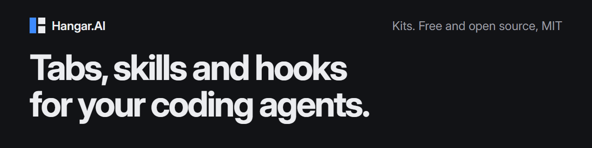

[Hangar.AI](https://hangar.simnjs.fr) runs a team of coding agents side by side, in one window: Claude Code, Codex, Gemini CLI and OpenCode, with a board and a memory they share. It is free and open source, in [its own repository](https://github.com/simnJS/hangar-ai).

A **kit** brings a domain into Hangar: a tab in the side panel, skills and hooks for Claude Code, commands that run tools already on your machine. Each kit is one repository here.

## Kits

| Kit | What it does |
| --- | --- |
| [Guardrails](https://github.com/hangar-ai/kit-guard) | Refuses dangerous commands and the reading of secrets before they run. You let one through once, from its tab. |
| [Éditeur](https://github.com/hangar-ai/kit-editor) | Opens a `.env` or a config file in a tab for you to fill in, so an agent that needs a secret goes on without seeing it. |
| [Recette](https://github.com/hangar-ai/kit-checklist) | You work through the manual checks an agent wrote, and the agent gets the result back to fix what failed. |
| [CI status](https://github.com/hangar-ai/kit-ci) | Follows a GitHub Actions run in a tab, opened by itself after a `git push`. |
| [GitHub](https://github.com/hangar-ai/kit-github) | The repository's open pull requests and issues, each handed to an agent in one click. |

## Install one

In Hangar, open **Settings › Kits › Library** and install a kit. Nothing runs yet. When you enable it on a workspace, you see every command, hook and permission it asks for, and you accept them there.

The Library reads a static file, [catalog/index.json](https://github.com/hangar-ai/catalog). There is no server of ours behind it. Each kit is pinned to a tag, so a new version reaches you only after it has been reviewed.

## Make one

Start from [kit-template](https://github.com/hangar-ai/kit-template), and read [the kit contract](https://github.com/simnJS/hangar-ai/blob/main/docs/kits.md) and [Hangar UI](https://github.com/simnJS/hangar-ai/blob/main/docs/kit-ui.md). To list yours, [open a pull request on the catalog](https://github.com/hangar-ai/catalog). It stays marked unverified: only the kits of this organization are verified.
